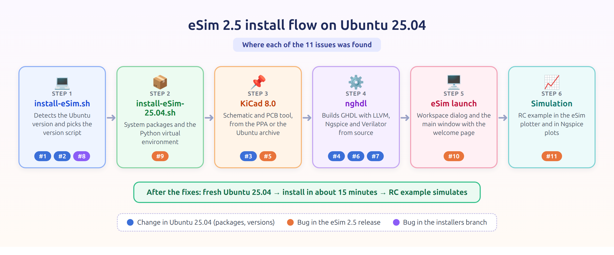
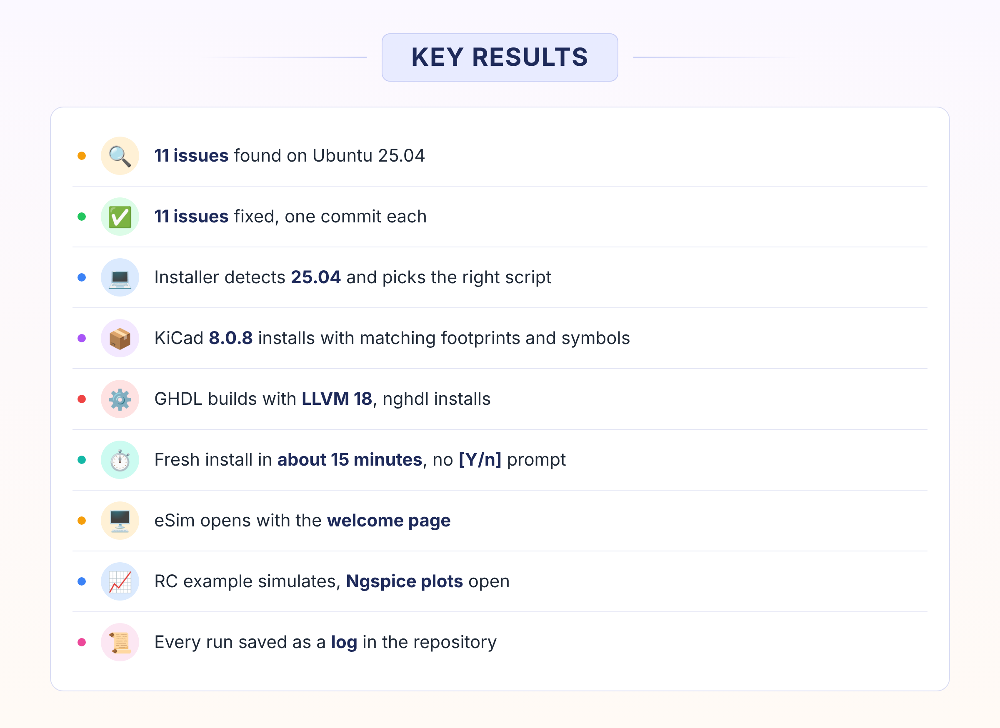
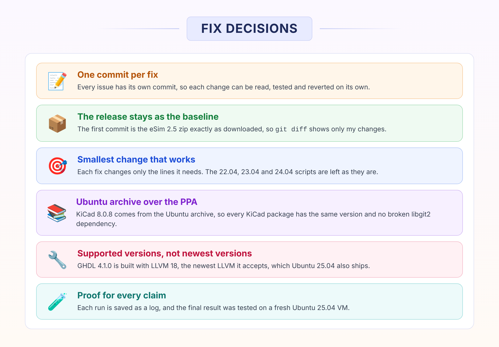
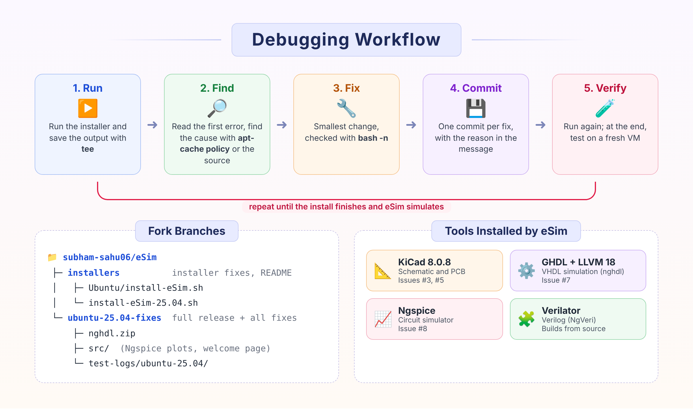
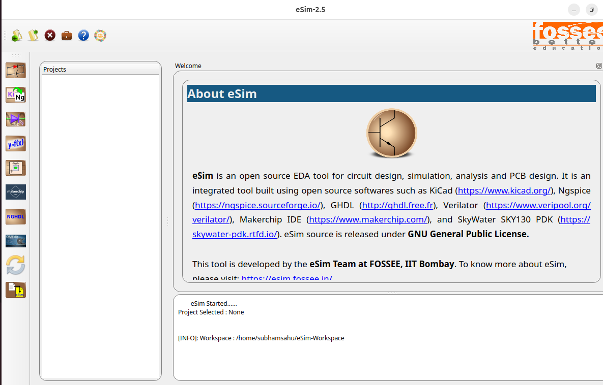
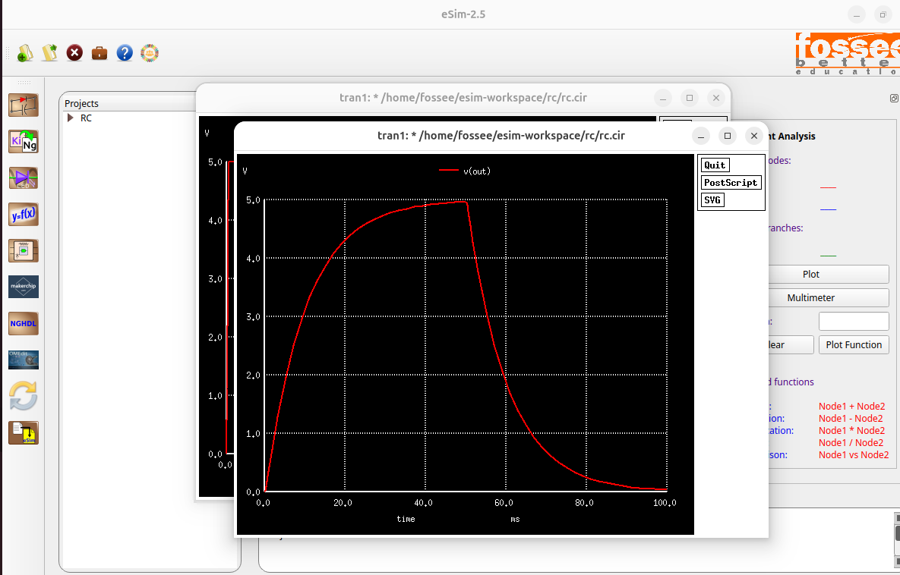

# 🛠️ eSim 2.5 on Ubuntu 25.04

> Making the eSim 2.5 installer work on Ubuntu 25.04: 11 issues found, 11 fixed, tested on a fresh system.

<p align="center">
  
</p>

<p align="center">
  <b>Screening Task 4 · FOSSEE Semester Long Internship - Autumn 2026</b>
</p>

---

## 📌 Overview

eSim is an open source EDA tool from FOSSEE, IIT Bombay. Its 2.5 release comes with an installer script for Ubuntu 22.04, 23.04 and 24.04.

This work makes that installer run on **Ubuntu 25.04**. Every fix is a separate commit, every problem has a log as proof, and the result was tested on a fresh Ubuntu 25.04 virtual machine.

---

## ❗ Problem Statement

On Ubuntu 25.04 the eSim 2.5 installer stops at the first step:

```
Detected Ubuntu Version:
Unsupported Ubuntu version: 25.04 ()
```

Past that first error there are more: some packages changed in 25.04, some were removed, and a few bugs in the release itself show up during install and in the eSim GUI.

---

## 🚀 Key Results

<p align="center">
  
</p>

Every install and launch log is in [`test-logs/ubuntu-25.04/`](https://github.com/subham-sahu06/eSim/tree/ubuntu-25.04-fixes/test-logs/ubuntu-25.04).

---

## 🌿 Branches

| Branch | What it holds |
| --- | --- |
| [`installers`](https://github.com/subham-sahu06/eSim/tree/installers) | Installer fixes on top of FOSSEE/eSim `installers`, one commit per fix, plus the notes file [`Ubuntu/UBUNTU-25.04-FIXES.md`](https://github.com/subham-sahu06/eSim/blob/installers/Ubuntu/UBUNTU-25.04-FIXES.md) |
| [`ubuntu-25.04-fixes`](https://github.com/subham-sahu06/eSim/tree/ubuntu-25.04-fixes) | The eSim 2.5 release zip as downloaded, then one commit per fix, then the test logs |

The `installers` branch has only the installer scripts. The fixes for `nghdl.zip` and `src/` need the full release, so they are on `ubuntu-25.04-fixes`.

---

## 🐞 Issues Found and Fixed

| # | Problem | Proof | Fix | Commit |
| --- | --- | --- | --- | --- |
| | **A. Critical installer blockers** | | | |
| 1 | Installer has no case for 25.04 and exits | [log 01](https://github.com/subham-sahu06/eSim/blob/ubuntu-25.04-fixes/test-logs/ubuntu-25.04/01-install-unmodified.log) | Add a 25.04 case and `install-eSim-25.04.sh` | [e8dc2e6](https://github.com/subham-sahu06/eSim/commit/e8dc2e6) |
| 2 | Detected version is empty on 25.04 | [log 01](https://github.com/subham-sahu06/eSim/blob/ubuntu-25.04-fixes/test-logs/ubuntu-25.04/01-install-unmodified.log) | Make the third part of the version optional | [254d8f2](https://github.com/subham-sahu06/eSim/commit/254d8f2) |
| 3 | KiCad from the PPA needs libgit2-1.8, which 25.04 does not have | [log 02](https://github.com/subham-sahu06/eSim/blob/ubuntu-25.04-fixes/test-logs/ubuntu-25.04/02-install-fixed.log) | Install KiCad 8.0.8 from the Ubuntu archive | [9d2e26f](https://github.com/subham-sahu06/eSim/commit/9d2e26f) |
| 4 | nghdl installer has issues 1 and 2 too | [log 03](https://github.com/subham-sahu06/eSim/blob/ubuntu-25.04-fixes/test-logs/ubuntu-25.04/03-install-kicad-fix.log) | Same fixes inside `nghdl.zip` | [859fd54](https://github.com/subham-sahu06/eSim/commit/859fd54) |
| 5 | `exit 0` in a function ends the whole installer if KiCad 8 is installed | [log 04](https://github.com/subham-sahu06/eSim/blob/ubuntu-25.04-fixes/test-logs/ubuntu-25.04/04-install-nghdl-fix.log) | Use `return 0` | [a7cda98](https://github.com/subham-sahu06/eSim/commit/a7cda98) |
| 6 | `libcanberra-gtk-module` has no installation candidate | [log 05](https://github.com/subham-sahu06/eSim/blob/ubuntu-25.04-fixes/test-logs/ubuntu-25.04/05-install-kicad-return.log) | Install only `libcanberra-gtk3-module` | [0079645](https://github.com/subham-sahu06/eSim/commit/0079645) |
| 7 | GHDL 4.1.0 does not accept LLVM 20 | [log 06](https://github.com/subham-sahu06/eSim/blob/ubuntu-25.04-fixes/test-logs/ubuntu-25.04/06-install-canberra-fix.log) | Build GHDL with `llvm-18` | [6e7d99a](https://github.com/subham-sahu06/eSim/commit/6e7d99a) |
| 8 | `Ubuntu/install-eSim.sh` on the `installers` branch has a syntax error | `bash -n` | Restore the `else` branch, remove leftover lines | [4819756](https://github.com/subham-sahu06/eSim/commit/4819756) |
| | **B. Installer and runtime fixes** | | | |
| 9 | `apt install python3-virtualenv` waits for [Y/n] | [log 02](https://github.com/subham-sahu06/eSim/blob/ubuntu-25.04-fixes/test-logs/ubuntu-25.04/02-install-fixed.log) | Add `-y` | [f1546f1](https://github.com/subham-sahu06/eSim/commit/f1546f1) |
| 10 | Welcome page is empty on Linux | [log 08](https://github.com/subham-sahu06/eSim/blob/ubuntu-25.04-fixes/test-logs/ubuntu-25.04/08-esim-launch.log) | Look for `welcome.html` two folders up | [9dbcc8a](https://github.com/subham-sahu06/eSim/commit/9dbcc8a) |
| | **C. Simulation fixes** | | | |
| 11 | "Ngspice plots" passes the binary `.raw` file to ngspice as input | [log 10](https://github.com/subham-sahu06/eSim/blob/ubuntu-25.04-fixes/test-logs/ubuntu-25.04/10-esim-ngspice-plot-fix.log) | Pass the netlist, and the `.raw` file with `-r` | [80ad808](https://github.com/subham-sahu06/eSim/commit/80ad808) |

On the `installers` branch, fixes 2, 3, 5 and 9 are [9ce4c02](https://github.com/subham-sahu06/eSim/commit/9ce4c02), [3e12cc5](https://github.com/subham-sahu06/eSim/commit/3e12cc5), [4c24b95](https://github.com/subham-sahu06/eSim/commit/4c24b95) and [481390d](https://github.com/subham-sahu06/eSim/commit/481390d).

---

## 🔬 Issue Details

Click an issue to open it.

### A. Critical installer blockers

<details>
<summary><b>1. No 25.04 case in install-eSim.sh</b></summary>

The `case $VERSION_ID` block only has 22.04, 23.04 and 24.04, so 25.04 falls into `*)` and the script prints "Unsupported Ubuntu version: 25.04 ()" and exits. I added a 25.04 case and created `install-eSim-25.04.sh` from the 24.04 script. The only other change in it is the KiCad part (issue 3).
</details>

<details>
<summary><b>2. Empty FULL_VERSION</b></summary>

The script reads the full version with:

```sh
FULL_VERSION=$(lsb_release -d | grep -oP '\d+\.\d+\.\d+')
```

This needs three numbers, but on 25.04 `lsb_release -d` prints only "Ubuntu 25.04". The new pattern makes the third number optional:

```sh
FULL_VERSION=$(lsb_release -d | grep -oP '\d+\.\d+(\.\d+)?')
```

It gives `25.04` on 25.04 and still `22.04.4` for "Ubuntu 22.04.4 LTS", so the existing 22.04.4 check keeps working.
</details>

<details>
<summary><b>3. KiCad PPA build does not install on 25.04</b></summary>

The `kicad-8.0-releases` PPA has kicad `8.0.9-0~ubuntu25.04.1` for plucky, and apt chooses it. It depends on `libgit2-1.8`, but 25.04 only has `libgit2-1.9` (1.9.0+ds-1ubuntu1), so apt stops with:

```
kicad : Depends: libgit2-1.8 (>= 1.8.0) but it is not installable
```

Ubuntu 25.04 has KiCad 8.0.8 in its own archive, so the 25.04 script does not add the PPA. All KiCad packages then come from the archive at the same version.

I also checked pinning `kicad=8.0.8+dfsg-1` while keeping the PPA. With the PPA added, `kicad-footprints` and `kicad-symbols` still come as 8.0.9, so using only the archive keeps every KiCad package at one version.
</details>

<details>
<summary><b>4. Same version bugs in the nghdl installer</b></summary>

`nghdl/install-nghdl.sh` has the same `case` block and the same version pattern, so it also printed "Unsupported Ubuntu version: 25.04 ()". I applied fixes 1 and 2 there and added `install-nghdl-25.04.sh`, a copy of the 24.04 script, which contains no version numbers.

The eSim installer unpacks `nghdl.zip` again on every run, so the fixes were packed back into `nghdl.zip`. The changes are also shown as a plain diff in [`nghdl-zip-changes.diff`](https://github.com/subham-sahu06/eSim/blob/ubuntu-25.04-fixes/test-logs/ubuntu-25.04/nghdl-zip-changes.diff).
</details>

<details>
<summary><b>5. exit 0 stops the whole installer</b></summary>

In `installKicad`, if KiCad 8 is already installed, the script runs `exit 0`. Inside a function this ends the whole installer, so nghdl and every later step are skipped without any message. This happens on a second run or on any system that already has KiCad 8. `return 0` leaves only the function.
</details>

<details>
<summary><b>6. GTK2 canberra module is not available</b></summary>

`apt-cache policy` shows no candidate for `libcanberra-gtk-module` (GTK2) on 25.04. `libcanberra-gtk3-module` 0.30-17ubuntu2 is available, so the 25.04 nghdl script installs only that one.
</details>

<details>
<summary><b>7. GHDL 4.1.0 and LLVM 20</b></summary>

nghdl builds GHDL 4.1.0 from source. Its `configure` accepts LLVM versions up to 18.1 and prints "Unhandled version llvm 20.1.2" for the default LLVM on 25.04. `llvm-18` (1:18.1.8-17) is in the 25.04 archive, so the 25.04 script installs `llvm-18` and `llvm-18-dev` and builds with:

```sh
./configure --with-llvm-config=/usr/bin/llvm-config-18
```
</details>

<details>
<summary><b>8. Syntax error on the installers branch</b></summary>

The task asks to commit on the `installers` branch, so I checked its `Ubuntu/install-eSim.sh` as well. `bash -n` reports "syntax error near unexpected token '}'" at line 70: after the merge of 2026-05-29, `run_version_script` holds lines that belong to the version scripts and is missing its `else` branch. I restored the `else` branch and removed the extra lines; the main part of the script does not use them. The file now passes `bash -n`.

On the `installers` branch I then applied fixes 2, 3, 5 and 9, one commit each. Its `install-eSim-25.04.sh` is now the same file that was tested on the fresh system.
</details>

### B. Installer and runtime fixes

<details>
<summary><b>9. A prompt in the middle of the install</b></summary>

Line 163 of the 25.04 script runs `sudo apt install python3-virtualenv` without `-y`, so the install stops at "Continue? [Y/n]". All other apt calls already use `-y`, so I added it here too.
</details>

<details>
<summary><b>10. Empty welcome page</b></summary>

eSim printed:

```
QTextBrowser: No document for file:///.../src/browser/library/browser/welcome.html
```

`Welcome.py` uses the `.exe` folder on Windows, and otherwise `os.path.dirname(__file__)`, which is `src/browser`. The file is at `library/browser/welcome.html`, two folders up. The fix changes only the non-Windows path.
</details>

### C. Simulation fixes

<details>
<summary><b>11. Ngspice plots read the .raw file as a netlist</b></summary>

After "Do you want Ngspice plots?" → Yes, the xterm showed "UTF-8 syntax error in line 14" and "fatal error in ngspice". In the release, line 138 of `src/ngspiceSimulation/NgspiceWidget.py` is:

```python
commandi = f'cd "{projPath}"; ngspice -p "{raw_file}"'
```

So ngspice reads the binary `.raw` output as its input file. The xterm title `RC.raw"` confirmed which file was last on the command line. Running `ngspice -r RC.raw RC.cir.out` by hand, and the same command inside xterm, worked. The fix passes the netlist as input and the `.raw` file with `-r`, as in the v2.5 tag on GitHub:

```python
commandi = f'cd "{projPath}"; ngspice -r "{raw_file}" "{os.path.abspath(command)}"'
```
</details>


---

## 🧠 Fix Decisions

<p align="center">
  
</p>

---

## 🧪 Method

<p align="center">
  
</p>

1. Run `./install-eSim.sh --install` and save the output with `tee`.
2. Read the first error and find its cause in the script, in `apt-cache policy`, or in the eSim source.
3. Make the smallest fix, check the shell syntax with `bash -n`, and commit it alone.
4. Run the installer again until it finishes, then start eSim and simulate an example.

**Test setup**

| Item | Value |
| --- | --- |
| Machine | KVM virtual machine (virt-manager) on Linux Mint 22.3; 4 GB RAM, 4 vCPU, 30 GB disk |
| OS | Ubuntu 25.04 desktop (plucky), kernel 6.14.0-37-generic, Python 3.13.3 |
| Starting state | Fresh install, fully updated, git installed, gcc not installed |
| eSim | `eSim-2.5.zip` from static.fossee.in, SHA256 `b9860ae26f026930bae589520761f4a57b85d593a2e2cd1ac83d5e5db2f281ed` |
| Baseline commit | [`2c256e5`](https://github.com/subham-sahu06/eSim/commit/2c256e5) "eSim 2.5 as downloaded" |

---

## ✅ Results on a Fresh Ubuntu 25.04 System

| Check | Result |
| --- | --- |
| Ubuntu version detected | "Detected Ubuntu Version: 25.04", `install-eSim-25.04.sh` selected |
| Full install | Ends with "eSim Installed Successfully" (KiCad, nghdl with GHDL and LLVM 18, Verilator, SKY130 PDK) |
| No prompts | `grep -c '\[Y/n\]' install.log` returns 0 |
| Welcome page | Shows "About eSim"; the QTextBrowser message no longer appears |
| RC example | Simulates; the eSim plotter shows the `in` and `out` nodes |
| Ngspice plots | `v(out)` charging curve and `v(in)` pulse open without errors |

### 📸 Install finished

<p align="center">
  
</p>

### 📸 eSim with the welcome page

<p align="center">
  
</p>

### 📸 Ngspice plot of the RC example

<p align="center">
  
</p>

---

## ⚙️ How to Reproduce

On a fresh Ubuntu 25.04 system:

```sh
git clone --single-branch -b ubuntu-25.04-fixes https://github.com/subham-sahu06/eSim.git
cd eSim
./install-eSim.sh --install
esim
```

Answer `n` to the proxy question. Then open `Examples/RC`, click Simulate, and choose Yes for Ngspice plots. To see a single fix, use `git show <commit>`.

---

## 📂 What Is Where

```
installers branch
├── README.md                         # this page
├── docs/ubuntu-25.04/                # diagram and screenshots
└── Ubuntu/
    ├── install-eSim.sh               # issues 2 and 8
    ├── install-eSim-scripts/
    │   └── install-eSim-25.04.sh     # issues 3, 5 and 9
    └── UBUNTU-25.04-FIXES.md         # short notes

ubuntu-25.04-fixes branch
├── install-eSim.sh                   # issues 1 and 2
├── install-eSim-scripts/
│   └── install-eSim-25.04.sh         # issues 3, 5 and 9
├── nghdl.zip                         # issues 4, 6 and 7
├── src/ngspiceSimulation/NgspiceWidget.py   # issue 11
├── src/browser/Welcome.py            # issue 10
└── test-logs/ubuntu-25.04/           # every install and launch log
```

---

## 🔭 Suggestions for Further Work

- Make the main window appear on the very first launch too. On the first launch the workspace is created and the windows are built (`xwininfo` lists them); the next step is to check how they are shown after the workspace dialog.
- Use `rm -f` for the old ngspice link, so the "cannot remove /usr/bin/ngspice" message stays out of the install output on a fresh system.
- Add an option to skip the proxy question, so the installer can run unattended, for example in automated tests.
- Add a free-space note to the install instructions, since building GHDL and Verilator needs several GB.
- Apply the same steps to the newer eSim v2.6 release; this work covers the 2.5 release named in the task.

---

## 👨‍💻 Author

**Subham Sahu**
B.Tech, Computer Science and Engineering (AI & ML)
NIST University, Berhampur, Odisha
GitHub: [@subham-sahu06](https://github.com/subham-sahu06)

*Submitted as Screening Task 4 (eSim Upgradation) for the FOSSEE Semester Long Internship - Autumn 2026.*

---

*The original README of this branch follows.*


[](https://www.python.org/dev/peps/pep-0008/)

[](https://esim.readthedocs.io/en/latest/?badge=latest)
[](https://github.com/fossee/esim/network)
[](https://github.com/fossee/esim)


## eSim

[eSim](https://esim.fossee.in/) is an open source EDA tool for circuit design, simulation, analysis and PCB design, developed by [FOSSEE Team](https://www.fossee.in/) at [IIT Bombay](https://www.iitb.ac.in/).
It is an integrated tool build using open source softwares such as KiCad, Ngspice and GHDL.

## Releases and Installation
eSim is released for the following distributions (operating systems):
* Ubuntu 18.04, 20.04 LTS versions.
* Microsoft Windows 8, 10 and 11.

To use eSim on your machine having above distributions, please refer to link [here](https://esim.fossee.in/downloads) for installation and other guidelines.

> Note for other distributions: You can refer [`installers`](https://github.com/fossee/eSim/tree/installers) branch for documentation on packaging (for above mentioned distributions) to build installers for your operating system in a similar way. For providing your build, please check the `Contribution` section mentioned below.

## Features
* An open-source EDA tool.
* Perform Circuit Design.
* Perform Simulation.
* Perform Layout Design.
* Model and Subcircuit builder.
* Support for Mixed-Signal Simulations including Microcontrollers.
* eSim has been successfully ported to low cost FOSSEE [laptop](https://laptop.fossee.in/)

## Open-Source Softwares Used
* [Python](https://www.python.org/)
* [KiCad](https://www.kicad.org/)
* [NGHDL](https://github.com/fossee/nghdl/)
* [Makerchip](https://www.makerchip.com/)
* [SkyWater SKY130 PDK](https://skywater-pdk.rtfd.io/)

## eSim Manual
To know everything about eSim, how it works and it's feature please download the manual from [here](https://static.fossee.in/esim/manuals/eSim_Manual_2.5.pdf)

## Contact
For any queries regarding eSim please write us on at this [email address](mailto:contact-esim@fossee.in).

## Contribution
Please refer [here](https://github.com/FOSSEE/eSim/blob/master/CONTRIBUTION.md) for further details.

## License
It is developed by FOSSEE Team at IIT Bombay and is released under GNU GPL License.
