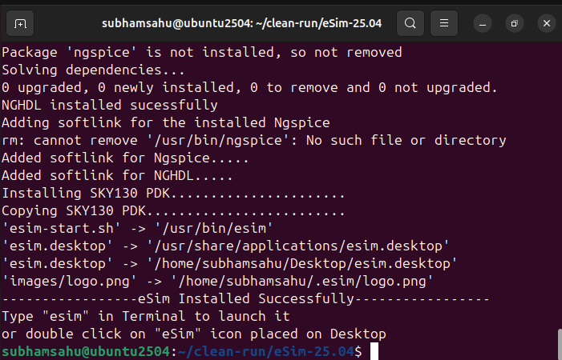

# eSim 2.5 on Ubuntu 25.04: Screening Task 4

**Subham Sahu, FOSSEE Winter Internship 2026**
B.Tech, Computer Science and Engineering (AI & ML), NIST University, Berhampur, Odisha

## Contents

1. [Task](#task)
2. [Summary](#summary)
3. [Repository links](#repository-links)
4. [Test setup](#test-setup)
5. [Method](#method)
6. [Issues found and fixed](#issues-found-and-fixed)
7. [Issue details](#issue-details)
8. [Testing after the fixes](#testing-after-the-fixes)
9. [How to reproduce](#how-to-reproduce)
10. [Suggestions for further work](#suggestions-for-further-work)

## Task

The task was to install eSim 2.5 on Ubuntu 25.04, find the problems in the installation, and fix at least one of them by changing the installer scripts. The fixes had to be committed to the `installers` branch of a fork of the eSim repository, with a documented report.

## Summary

The eSim 2.5 release installer does not run on Ubuntu 25.04: it stops at once with *"Unsupported Ubuntu version: 25.04 ()"*. I found 11 issues and fixed each one in its own commit. After the fixes, eSim installs on a fresh Ubuntu 25.04 system, starts, and simulates the RC example with both the eSim plotter and the Ngspice plots.

- Issues 1–4, 6 and 7 come from changes in Ubuntu 25.04 (new package versions).
- Issues 5, 8, 9 and 10 are bugs in the 2.5 release itself, found while testing on 25.04.
- Issue 11 is a bug in the `installers` branch.

## Repository links

| Branch | Contents |
| --- | --- |
| [`installers`](https://github.com/subham-sahu06/eSim/tree/installers) | Installer fixes on top of FOSSEE/eSim `installers`, one commit per fix, with this summary and the notes file [`Ubuntu/UBUNTU-25.04-FIXES.md`](https://github.com/subham-sahu06/eSim/blob/installers/Ubuntu/UBUNTU-25.04-FIXES.md) |
| [`ubuntu-25.04-fixes`](https://github.com/subham-sahu06/eSim/tree/ubuntu-25.04-fixes) | The eSim 2.5 release as downloaded, then one commit per fix, then the test logs in [`test-logs/ubuntu-25.04/`](https://github.com/subham-sahu06/eSim/tree/ubuntu-25.04-fixes/test-logs/ubuntu-25.04) |

The `installers` branch contains only the installer scripts. The fixes for `nghdl.zip` and `src/` need the full release, so they are on `ubuntu-25.04-fixes`.

## Test setup

| Item | Value |
| --- | --- |
| Machine | KVM virtual machine (virt-manager) on Linux Mint 22.3; 4 GB RAM, 4 vCPU, 30 GB disk |
| OS | Ubuntu 25.04 desktop (plucky), kernel 6.14.0-37-generic, Python 3.13.3 |
| Starting state | Fresh install, fully updated, git installed, gcc not installed |
| eSim | `eSim-2.5.zip` from static.fossee.in |
| SHA256 | `b9860ae26f026930bae589520761f4a57b85d593a2e2cd1ac83d5e5db2f281ed` |
| Baseline commit | [`2c256e5`](https://github.com/subham-sahu06/eSim/commit/2c256e5) "eSim 2.5 as downloaded" (the zip contents, unchanged) |

## Method

I changed one thing at a time and ran the installer again after every fix:

1. Run `./install-eSim.sh --install` and save the output with `tee`.
2. Read the first error and find its cause in the script, in `apt-cache policy`, or in the eSim source.
3. Make the smallest fix, check the shell syntax with `bash -n`, and commit it alone.
4. Run the installer again until it finishes, then start eSim and simulate an example.

The nghdl installer is inside `nghdl.zip`, and the eSim installer unpacks it again on every run. So nghdl fixes were made in the unpacked folder and packed back into `nghdl.zip`. Since a diff inside a zip is not visible on GitHub, the branch also has [`nghdl-zip-changes.diff`](https://github.com/subham-sahu06/eSim/blob/ubuntu-25.04-fixes/test-logs/ubuntu-25.04/nghdl-zip-changes.diff).

## Issues found and fixed

Each log and commit below is a link.

| # | Problem | Proof (log) | Fix | Commit |
| --- | --- | --- | --- | --- |
| 1 | Installer has no case for 25.04 and exits | [Log 01](https://github.com/subham-sahu06/eSim/blob/ubuntu-25.04-fixes/test-logs/ubuntu-25.04/01-install-unmodified.log) | Add a 25.04 case and `install-eSim-25.04.sh` | [e8dc2e6](https://github.com/subham-sahu06/eSim/commit/e8dc2e6) |
| 2 | Detected version is empty on 25.04 | [Log 01](https://github.com/subham-sahu06/eSim/blob/ubuntu-25.04-fixes/test-logs/ubuntu-25.04/01-install-unmodified.log) | Make the third part of the version optional | [254d8f2](https://github.com/subham-sahu06/eSim/commit/254d8f2) |
| 3 | KiCad from the PPA needs libgit2-1.8, which 25.04 does not have | [Log 02](https://github.com/subham-sahu06/eSim/blob/ubuntu-25.04-fixes/test-logs/ubuntu-25.04/02-install-fixed.log) | Install KiCad 8.0.8 from the Ubuntu archive | [9d2e26f](https://github.com/subham-sahu06/eSim/commit/9d2e26f) |
| 4 | nghdl installer has issues 1 and 2 too | [Log 03](https://github.com/subham-sahu06/eSim/blob/ubuntu-25.04-fixes/test-logs/ubuntu-25.04/03-install-kicad-fix.log) | Same fixes inside `nghdl.zip` | [859fd54](https://github.com/subham-sahu06/eSim/commit/859fd54) |
| 5 | `exit 0` in a function ends the whole installer if KiCad 8 is installed | [Log 04](https://github.com/subham-sahu06/eSim/blob/ubuntu-25.04-fixes/test-logs/ubuntu-25.04/04-install-nghdl-fix.log) | Use `return 0` | [a7cda98](https://github.com/subham-sahu06/eSim/commit/a7cda98) |
| 6 | `libcanberra-gtk-module` has no installation candidate | [Log 05](https://github.com/subham-sahu06/eSim/blob/ubuntu-25.04-fixes/test-logs/ubuntu-25.04/05-install-kicad-return.log) | Install only `libcanberra-gtk3-module` | [0079645](https://github.com/subham-sahu06/eSim/commit/0079645) |
| 7 | GHDL 4.1.0 does not accept LLVM 20 | [Log 06](https://github.com/subham-sahu06/eSim/blob/ubuntu-25.04-fixes/test-logs/ubuntu-25.04/06-install-canberra-fix.log) | Build GHDL with `llvm-18` | [6e7d99a](https://github.com/subham-sahu06/eSim/commit/6e7d99a) |
| 8 | "Ngspice plots" passes the binary `.raw` file to ngspice as input | [Log 10](https://github.com/subham-sahu06/eSim/blob/ubuntu-25.04-fixes/test-logs/ubuntu-25.04/10-esim-ngspice-plot-fix.log) | Pass the netlist, and the `.raw` file with `-r` | [80ad808](https://github.com/subham-sahu06/eSim/commit/80ad808) |
| 9 | `apt install python3-virtualenv` waits for [Y/n] | [Log 02](https://github.com/subham-sahu06/eSim/blob/ubuntu-25.04-fixes/test-logs/ubuntu-25.04/02-install-fixed.log) | Add `-y` | [f1546f1](https://github.com/subham-sahu06/eSim/commit/f1546f1) |
| 10 | Welcome page is empty on Linux | [Log 08](https://github.com/subham-sahu06/eSim/blob/ubuntu-25.04-fixes/test-logs/ubuntu-25.04/08-esim-launch.log) | Look for `welcome.html` two folders up | [9dbcc8a](https://github.com/subham-sahu06/eSim/commit/9dbcc8a) |
| 11 | `Ubuntu/install-eSim.sh` on the `installers` branch has a syntax error | `bash -n` output | Restore the `else` branch, remove leftover lines | [4819756](https://github.com/subham-sahu06/eSim/commit/4819756) |

On the `installers` branch, fixes 2, 3, 5 and 9 are the commits [9ce4c02](https://github.com/subham-sahu06/eSim/commit/9ce4c02), [3e12cc5](https://github.com/subham-sahu06/eSim/commit/3e12cc5), [4c24b95](https://github.com/subham-sahu06/eSim/commit/4c24b95) and [481390d](https://github.com/subham-sahu06/eSim/commit/481390d).

## Issue details

### 1. No 25.04 case in install-eSim.sh

The `case $VERSION_ID` block only has 22.04, 23.04 and 24.04, so 25.04 falls into `*)` and the script prints "Unsupported Ubuntu version: 25.04 ()" and exits. I added a 25.04 case and created `install-eSim-25.04.sh` from the 24.04 script. The only other change in it is the KiCad part (issue 3).

### 2. Empty FULL_VERSION

The script reads the full version with:

```sh
FULL_VERSION=$(lsb_release -d | grep -oP '\d+\.\d+\.\d+')
```

This needs three numbers, but on 25.04 `lsb_release -d` prints only "Ubuntu 25.04". The new pattern makes the third number optional:

```sh
FULL_VERSION=$(lsb_release -d | grep -oP '\d+\.\d+(\.\d+)?')
```

It gives `25.04` on 25.04 and still `22.04.4` for "Ubuntu 22.04.4 LTS", so the existing 22.04.4 check keeps working.

### 3. KiCad PPA build does not install on 25.04

The `kicad-8.0-releases` PPA has kicad `8.0.9-0~ubuntu25.04.1` for plucky, and apt chooses it. It depends on `libgit2-1.8`, but 25.04 only has `libgit2-1.9` (1.9.0+ds-1ubuntu1), so apt stops with:

```
kicad : Depends: libgit2-1.8 (>= 1.8.0) but it is not installable
```

Ubuntu 25.04 has KiCad 8.0.8 in its own archive, so the 25.04 script does not add the PPA. All KiCad packages then come from the archive at the same version.

I also checked pinning `kicad=8.0.8+dfsg-1` while keeping the PPA. With the PPA added, `kicad-footprints` and `kicad-symbols` still come as 8.0.9, so using only the archive keeps every KiCad package at one version.

### 4. Same version bugs in the nghdl installer

`nghdl/install-nghdl.sh` has the same `case` block and the same version pattern, so it also printed "Unsupported Ubuntu version: 25.04 ()". I applied fixes 1 and 2 there and added `install-nghdl-25.04.sh`, a copy of the 24.04 script, which contains no version numbers.

### 5. exit 0 stops the whole installer

In `installKicad`, if KiCad 8 is already installed, the script runs `exit 0`. Inside a function this ends the whole installer, so nghdl and every later step are skipped without any message. This happens on a second run or on any system that already has KiCad 8. `return 0` leaves only the function.

### 6. GTK2 canberra module is not available

`apt-cache policy` shows no candidate for `libcanberra-gtk-module` (GTK2) on 25.04. `libcanberra-gtk3-module` 0.30-17ubuntu2 is available, so the 25.04 nghdl script installs only that one.

### 7. GHDL 4.1.0 and LLVM 20

nghdl builds GHDL 4.1.0 from source. Its `configure` accepts LLVM versions up to 18.1 and prints "Unhandled version llvm 20.1.2" for the default LLVM on 25.04. `llvm-18` (1:18.1.8-17) is in the 25.04 archive, so the 25.04 script installs `llvm-18` and `llvm-18-dev` and builds with:

```sh
./configure --with-llvm-config=/usr/bin/llvm-config-18
```

### 8. Ngspice plots read the .raw file as a netlist

After "Do you want Ngspice plots?" → Yes, the xterm showed "UTF-8 syntax error in line 14" and "fatal error in ngspice". In the release, line 138 of `src/ngspiceSimulation/NgspiceWidget.py` is:

```python
commandi = f'cd "{projPath}"; ngspice -p "{raw_file}"'
```

So ngspice reads the binary `.raw` output as its input file. The xterm title `RC.raw"` confirmed which file was last on the command line. Running `ngspice -r RC.raw RC.cir.out` by hand, and the same command inside xterm, worked. The fix passes the netlist as input and the `.raw` file with `-r`, as in the v2.5 tag on GitHub:

```python
commandi = f'cd "{projPath}"; ngspice -r "{raw_file}" "{os.path.abspath(command)}"'
```

### 9. A prompt in the middle of the install

Line 163 of the 25.04 script runs `sudo apt install python3-virtualenv` without `-y`, so the install stops at "Continue? [Y/n]". All other apt calls already use `-y`, so I added it here too.

### 10. Empty welcome page

eSim printed:

```
QTextBrowser: No document for file:///.../src/browser/library/browser/welcome.html
```

`Welcome.py` uses the `.exe` folder on Windows, and otherwise `os.path.dirname(__file__)`, which is `src/browser`. The file is at `library/browser/welcome.html`, two folders up. The fix changes only the non-Windows path.

### 11. Syntax error on the installers branch

The task asks to commit on the `installers` branch, so I checked its `Ubuntu/install-eSim.sh` as well. `bash -n` reports "syntax error near unexpected token '}'" at line 70: after the merge of 2026-05-29, `run_version_script` holds lines that belong to the version scripts and is missing its `else` branch. I restored the `else` branch and removed the extra lines; the main part of the script does not use them. The file now passes `bash -n`.

On the `installers` branch I then applied fixes 2, 3, 5 and 9, one commit each. Its `install-eSim-25.04.sh` is now the same file that was tested on the fresh system.

## Testing after the fixes

On a fresh Ubuntu 25.04 virtual machine, the `ubuntu-25.04-fixes` branch installed eSim in about 15 minutes. The only inputs needed were the answer to the proxy question and the sudo password. Before the run, gcc was not installed and no earlier eSim files were present.

| Check | Result |
| --- | --- |
| Ubuntu version detected | "Detected Ubuntu Version: 25.04", `install-eSim-25.04.sh` selected |
| Full install | Ends with "eSim Installed Successfully" (KiCad, nghdl with GHDL and LLVM 18, Verilator, SKY130 PDK) |
| No prompts | `grep -c '\[Y/n\]' install.log` returns 0 |
| Welcome page | Shows "About eSim"; the QTextBrowser message no longer appears |
| RC example | Simulates; the eSim plotter shows the `in` and `out` nodes |
| Ngspice plots | `v(out)` charging curve and `v(in)` pulse open without errors |

On the first launch, eSim set up the workspace (`~/eSim-Workspace` and `~/.esim/workspace.txt` were created), and from the second launch the main window opened directly every time.

<p align="center">
  <br>
  <em>Figure 1: End of the installer output on the fresh Ubuntu 25.04 system</em>
</p>

<p align="center">
  <br>
  <em>Figure 2: eSim main window with the welcome page</em>
</p>

<p align="center">
  <br>
  <em>Figure 3: Ngspice plot of v(out) for the RC example</em>
</p>

## How to reproduce

On a fresh Ubuntu 25.04 system:

```sh
git clone --single-branch -b ubuntu-25.04-fixes https://github.com/subham-sahu06/eSim.git
cd eSim
./install-eSim.sh --install
esim
```

Answer `n` to the proxy question. Then open `Examples/RC`, click Simulate, and choose Yes for Ngspice plots. To see a single fix, use `git show <commit>`.

## Suggestions for further work

- The main window can be made to appear on the very first launch too. On the first launch the workspace is created and the windows are built (`xwininfo` lists them); the next step is to check how they are shown after the workspace dialog.
- Using `rm -f` for the old ngspice link would keep the "cannot remove /usr/bin/ngspice" message out of the install output on a fresh system.
- An option to skip the proxy question would let the installer run unattended, for example in automated tests.
- Building GHDL and Verilator needs several GB of free disk space, so a free-space note in the install instructions would help users.
- The same steps can be applied to the newer eSim v2.6 release; this work covers the 2.5 release named in the task.

---

*The original README of this branch follows.*


eSim Packaging
====

It contains all the documentation for packaging eSim for distribution.


# Packaging eSim for Distribution:

1. eSim is currently packaged and distributed for Ubuntu OS (Linux) and MS Windows OS.

2. Refer the [documentation](Version_Change.md) for the changes to be done when a new release is to be made.

> Note: These changes have to be made `first` before proceeding with the packaging on either platform.

3. Refer the [documentation](Ubuntu/README.md) to package eSim for Ubuntu OS.

4. Refer the [documentation](Windows/README.md) to package eSim for Windows OS.
